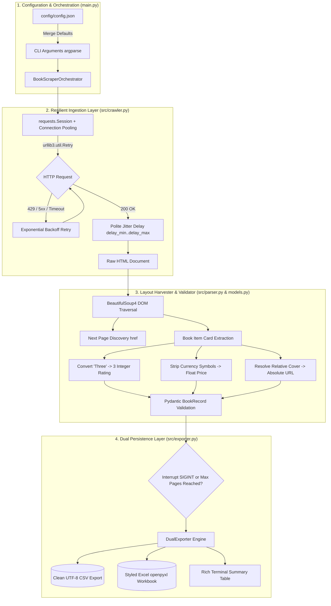

<div align="center">

# 📚 BookPulse: Resilient E-Commerce Catalog Scraper & Normalizer ⚡

**A production-grade, fault-tolerant Python crawler engineered to extract, normalize, and export large-scale e-commerce book catalogs into clean CSV & styled Excel datasets with polite throttling, Rich CLI analytics, and graceful SIGINT state flushing.**

[](https://www.python.org/)
[](https://opensource.org/licenses/MIT)
[](https://www.crummy.com/software/BeautifulSoup/)
[](https://docs.pydantic.dev/)
[](https://openpyxl.readthedocs.io/)
[](https://github.com/Textualize/rich)

<p align="center">
  <a href="#-overview--value-proposition">Overview</a> •
  <a href="#-architecture--crawler-workflow">Architecture</a> •
  <a href="#-key-features">Features</a> •
  <a href="#-quickstart">Quickstart</a> •
  <a href="#-extracted-schema">Data Schema</a> •
  <a href="#-configuration-reference">Configuration</a> •
  <a href="#-terminal-experience">CLI Experience</a> •
  <a href="#-testing--verification">Testing</a>
</p>

---

</div>

## 🎯 Overview & Value Proposition

Scraping dynamic e-commerce catalogs often fails due to fragile pagination, unexpected network dropouts, rate throttling, and messy data formats (e.g., star ratings formatted as CSS class names like `"star-rating Three"` or unstripped currency symbols like `"£51.77"`).

**BookPulse** solves this with an enterprise-ready, zero-hardcode architecture:
* **Demo Target:** [books.toscrape.com](https://books.toscrape.com) (50 pages / 1,000 products).
* **Zero Guesswork:** Clean separation between network session pooling, HTML extraction, Pydantic type validation, and dual CSV/Excel persistence.
* **SIGINT Trapping:** Hit `Ctrl+C` anytime—the engine catches the interrupt signal, safely flushes all crawled records to disk, and exits cleanly without losing a single book.

---

## 🏛️ Architecture & Crawler Workflow



---

## ✨ Key Features

| Feature | Description |
| :--- | :--- |
| 🛡️ **Pydantic Type Safety** | Every extracted book passes through strict data schemas: float prices, normalized integer star ratings (`1` to `5`), clean stock status, and resolved absolute image URLs. |
| 🔄 **Robust Retry Engine** | Built-in HTTP connection pooling using `urllib3.util.Retry` with automatic exponential backoff on HTTP `429`, `500`, `502`, `503`, and `504` status codes. |
| ⏱️ **Polite Throttling & Jitter** | Configurable randomized delays (`delay_min` to `delay_max`) between page queries prevent IP throttling, server overload, and bot detection. |
| 📊 **Simultaneous Dual Export** | Automatically streams extracted records to both standard UTF-8 **CSV** and styled **Excel** (`.xlsx`) spreadsheets with auto-adjusted column widths. |
| 🛑 **Graceful SIGINT Flushing** | Interrupting the process with `Ctrl+C` will **never** corrupt files or lose data—accumulated in-memory records are safely flushed to disk before exit. |
| ⚙️ **Zero Hardcoding** | Starting URLs, user agents, timeout intervals, delays, and output paths are 100% configurable via `config/config.json` or CLI overrides. |
| 💻 **Rich Terminal Analytics** | Live interactive progress bar displaying current processing speed, items crawled, and execution duration. |

---

## 🚀 Quickstart

### 1. Clone & Set Up Virtual Environment

```bash
# Clone the repository
git clone https://github.com/R3xo666/bookstore-catalog-scraper.git
cd bookstore-catalog-scraper

# Set up virtual environment
python3 -m venv .venv
source .venv/bin/activate  # On Windows: .venv\Scripts\activate

# Install dependencies
pip install -r requirements.txt
```

### 2. Run the Scraper

```bash
# Run default configuration (crawls 2 sample pages)
python3 main.py

# Scrape exactly 5 pages
python3 main.py --pages 5

# Scrape the entire 50-page catalog (1,000 books)
python3 main.py --pages 0

# Custom output destination and custom base filename
python3 main.py --pages 2 --output data/output --base-name catalog_sample
```

---

## 📋 Extracted Data Schema

Every product is verified and structured into the following standardized schema:

| Field | Type | Description | Sanitization Applied | Sample Output |
| :--- | :---: | :--- | :--- | :--- |
| `title` | `str` | Full product title | HTML entity decoded, stripped of whitespace | `"A Light in the Attic"` |
| `price` | `float` | Price in numeric format | Stripped currency symbols (`£`, `$`, `€`), converted to `float` | `51.77` |
| `rating` | `int` | Star rating integer (`1`–`5`) | Converted from CSS word class (`"Three"` $\rightarrow$ `3`) | `3` |
| `availability` | `str` | Stock status | Stripped whitespace, normalized | `"In stock"` |
| `image_url` | `str` | Direct cover image URL | Resolved from relative path to fully qualified absolute URL | `"https://books.toscrape.com/media/cache/...jpg"` |

---

## ⚙️ Configuration Reference (`config/config.json`)

```json
{
  "start_url": "https://books.toscrape.com/catalogue/page-1.html",
  "output_dir": "data/output",
  "max_pages": 2,
  "delay_min": 1.0,
  "delay_max": 2.0,
  "timeout": 15,
  "user_agent": "Mozilla/5.0 (X11; Linux x86_64) AppleWebKit/537.36 (KHTML, like Gecko) Chrome/130.0.0.0 Safari/537.36"
}
```

### CLI Command Options:
| Short | Long Flag | Description | Default |
| :---: | :--- | :--- | :--- |
| `-c` | `--config` | Path to JSON configuration file | `config/config.json` |
| `-u` | `--url` | Override catalog entry point URL | Set in config |
| `-p` | `--pages` | Max pages to crawl (`0` = crawl all pages until last) | `2` |
| `-o` | `--output` | Destination directory for exported files | `data/output` |
| `-b` | `--base-name` | Base filename prefix (without extension) | `books_YYYYMMDD_HHMMSS` |

---

## 🖥️ Terminal Experience

When running `main.py`, BookPulse provides clean visual feedback powered by `rich`:

```text
╭─────────────────────────────────────────────────────────────╮
│ 📚 Bookstore Catalog Scraper                                │
│ Production Data Ingestion & Dual CSV/Excel Export Pipeline  │
╰─────────────────────────────────────────────────────────────╯
Target: https://books.toscrape.com/catalogue/page-1.html
Max Pages: 2 | Output Directory: data/output

  Crawling: page-2.html ━━━━━━━━━━━━━━━━━━━━━━━━━━━━━━━━━ 2/2 0:00:03

                          Execution Summary                          
┏━━━━━━━━━━━━━━━━━━━━━━━━━━━━━━━┳━━━━━━━━━━━━━━━━━━━━━━━━━━━━━┓
┃ Metric                        ┃ Value                       ┃
┡━━━━━━━━━━━━━━━━━━━━━━━━━━━━━━━╇━━━━━━━━━━━━━━━━━━━━━━━━━━━━━┩
│ Total Pages Crawled           │ 2                           │
│ Total Books Extracted         │ 40                          │
│ CSV Export                    │ data/output/sample_2pages.csv│
│ Excel Export                  │ data/output/sample_2pages.xlsx│
│ Status                        │ Completed Successfully ✅    │
└───────────────────────────────┴─────────────────────────────┘
```

---

## 🧪 Testing & Verification

The codebase includes comprehensive unit tests verifying HTML parsing, numeric sanitization, rating conversion, and dual exporter file writes:

```bash
# Run unit test suite
pytest -v tests/
```

```text
============================= test session starts ==============================
platform linux -- Python 3.12+ -- pytest-9.1.1
collected 6 items

tests/test_parser.py::test_parse_book_item_valid PASSED                   [ 16%]
tests/test_parser.py::test_parse_rating_conversion PASSED                 [ 33%]
tests/test_parser.py::test_parse_next_page_link PASSED                    [ 50%]
tests/test_exporter.py::test_export_csv_creates_valid_file PASSED        [ 66%]
tests/test_exporter.py::test_export_excel_creates_valid_file PASSED      [ 83%]
tests/test_exporter.py::test_sigint_graceful_flush PASSED                [100%]

============================== 6 passed in 0.32s ===============================
```

---

## 📂 Project Structure

```text
bookstore-catalog-scraper/
├── config/
│   └── config.json             # Runtime configuration parameters
├── data/
│   └── output/                 # Destination for generated CSV/Excel files
│       ├── sample_2pages.csv   # Sample 2-page dataset (40 items)
│       └── sample_2pages.xlsx  # Styled Excel spreadsheet
├── src/
│   ├── __init__.py
│   ├── models.py               # Pydantic data models & sanitization
│   ├── crawler.py              # HTTP session pooling, exponential retries & polite delay
│   ├── parser.py               # HTML parser, rating conversion & URL resolution
│   └── exporter.py             # Dual CSV/Excel writer with openpyxl styling
├── tests/
│   ├── __init__.py
│   ├── test_parser.py          # Unit tests for parsing logic
│   └── test_exporter.py        # Unit tests for CSV/Excel generation
├── main.py                     # CLI entrypoint with argparse & Rich UI
├── requirements.txt            # Pinned dependencies
├── CODE_REVIEW_REPORT.md       # Architectural audit and code review
└── README.md                   # Full documentation
```

---

## 📄 License
This project is licensed under the **MIT License**.
